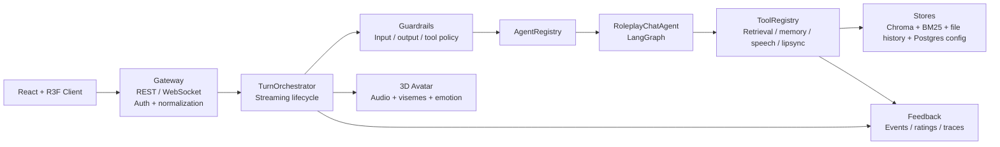

# Persona Graph AI — Real-Time Multimodal AI Agent Platform

An async FastAPI + WebSocket AI platform that powers a real-time 3D companion experience. The system combines LangGraph orchestration, hybrid Chroma + BM25 memory retrieval, tool-wrapped multimodal services, guardrails, feedback events, production-hardening boundaries, and a React Three Fiber avatar driven by audio, emotion, and viseme payloads.

This is not only a chatbot UI. It is a small AI engineering platform built around the model:

```text
Gateway -> Orchestrator -> AgentRegistry -> Agent -> ToolRegistry -> Guardrails -> Feedback
```

See the [local runtime guides](docs/guides/README.md) for setup, GPU tuning, microphone input, validation and rollback.

## Local inference on E: (WSL Docker + llama.cpp)

The default chat provider is llama.cpp CUDA, serving `Qwen/Qwen2.5-1.5B-Instruct-GGUF` (Q4_K_M)
as `persona-qwen`. Both routing tiers use this one model to avoid loading two
models on a 4 GB GPU. Ollama is used only for CPU Nomic embeddings, preserving
the existing Chroma embedding space.

To keep model data off C:, place Ubuntu on E: (this machine: `E:\WSL\Ubuntu`). Install the independent
Docker Engine and NVIDIA Container Toolkit once:

```powershell
wsl -d Ubuntu -u root -- bash /mnt/d/Coder-IT/AI/persona-graph-ai/scripts/setup-wsl-docker.sh
```

For a new checkout, copy `backend/.env.example` to `backend/.env` and configure
a private `AUTH_TOKEN_SECRET`. Keep an existing `.env` when upgrading. Adjust
the example WSL paths below to match your checkout.

Manage this project's WSL daemon from PowerShell:

```powershell
wsl -d Ubuntu -u root -- bash /mnt/d/Coder-IT/AI/persona-graph-ai/scripts/download-llama-model.sh
./scripts/wsl-compose.ps1 up -d llama-cpp ollama postgres
./scripts/wsl-compose.ps1 exec ollama ollama pull nomic-embed-text
./scripts/wsl-compose.ps1 logs --tail 80 llama-cpp
```

The wrapper explicitly uses `unix:///run/persona-docker.sock`. Plain Windows
`docker` commands may still target Docker Desktop and unrelated projects.
Images and named volumes reside in Ubuntu at `/var/lib/persona-docker`, inside
the E:-backed virtual disk. Model weights persist in the `llama_models`
volume, not in the repository or Windows C: cache.

For the existing Windows development backend, use `backend/.venv` as before.
The configured endpoints are llama.cpp `http://localhost:8080/v1`, CPU embeddings
`http://localhost:11435`, and Postgres `localhost:5433`. The frontend uses backend
port 8001. Optional complete container deployment:

```powershell
./scripts/wsl-compose.ps1 --profile app up -d --build
```

Local preset speech uses **Kokoro v1.0 INT8 ONNX on CPU**, with no GPU allocation or
cloud billing dependency. The app profile starts the `kokoro` service on
`http://localhost:8880`; the backend connects internally to
`http://kokoro:8080/synthesize`. Native Windows backend configuration uses
`TTS_PROVIDER=kokoro` and `KOKORO_TTS_URL=http://localhost:8880/synthesize`.

The English voice picker lists Kokoro presets (Luna: `af_bella`, Kai:
`am_michael`). Kokoro does not clone uploaded voice samples, control emotions,
or natively support Vietnamese. The model and matching voice pack are downloaded
once during image build; inference stays local. The CPU service is limited to
four cores and 2 GiB RAM. `/ready` checks its actual model health, and chat still
falls back to text if speech fails.

```powershell
./scripts/wsl-compose.ps1 --profile app up -d --build kokoro
./scripts/wsl-compose.ps1 logs --tail 40 kokoro
Invoke-RestMethod http://localhost:8880/health
```

English voice cloning uses **Chatterbox-Nano on CPU**, with Kokoro retained for
preset voices and synthesis failures. The `app` profile starts Nano at
`http://localhost:8881`, persists its pinned model files in `chatterbox_models`,
and shares reference recordings through `voice_samples`. Nano is limited to four
CPU cores and 4 GiB RAM. Its complete checkpoints occupy about 1.9 GiB on disk;
the published 110M label does not describe the full deployment's disk/RAM needs.

In **Avatar & Voice Options**, choose **Record my voice (12 seconds)** or upload
a clean 10–15 second English recording. Clips must be longer than 5 seconds and
at most 30 seconds, with a 10 MB upload limit. The backend converts the clip to
mono PCM16 WAV and automatically selects it. Click **Preview voice**, enable TTS,
and send a message. Uploaded voices are scoped to your login, survive container
recreation, and reuse cached conditioning across sentences. Preview reports
errors instead of substituting a different speaker; chat uses Kokoro on failure.

The first start downloads model files; the UI reports loading/unavailability
while preset speech remains usable. The local benchmark generated 2.88 seconds
of audio in 17.4 seconds on the first reference request, then 2.6 seconds in
4.2 seconds with caching. Nano used about 3 GiB RAM. Voice cloning works on this
laptop, but CPU generation is slower than real time and has more latency than
Kokoro. The default character voices remain Kokoro presets until you select a
recording.

```powershell
./scripts/wsl-compose.ps1 --profile app up -d --build
Invoke-RestMethod http://localhost:8881/health
./scripts/wsl-compose.ps1 logs --tail 40 chatterbox
```

`wsl-compose.ps1 up` starts a managed hidden WSL keep-alive to prevent idle VM
shutdown from interrupting model downloads or inference. `down` stops that
helper. Native Windows backend configuration uses `TTS_PROVIDER=chatterbox-nano`
and `CHATTERBOX_TTS_URL=http://localhost:8881/synthesize`. Model code and model
revisions are pinned in `chatterbox-service/`. Standard Nano cloning is English.

The container backend is exposed at port 8001 and frontend at port 8088.
For a one-click test login, set `DEV_QUICK_LOGIN_ENABLED=true` in `backend/.env`
and restart/recreate the backend. The login screen then shows **Quick login as
Dev Tester**, which creates/reuses a dedicated test account. The option defaults
to false and is always disabled when `DEPLOYMENT_MODE=cloud`, even if the flag is
true. No password is embedded in the frontend.

Stop a development backend on 8001 before starting the container backend.
See [WSL migration guide](docs/guides/WSL_VLLM_MIGRATION.md) for backups,
verification, GPU limits, and cleanup. Historical Ollama chat setup below is
retained for reference; it is no longer the default deployment.


## Production AI Engineering Highlights

| Engineering Problem | Implementation |
|---|---|
| Keep user/character memories isolated | Metadata-scoped retrieval by `user_id` and `character_id`; Stage 7 derives `user_id` from auth/dev context instead of trusting the client payload. |
| Recover exact facts that embeddings miss | Hybrid dense Chroma retrieval + sparse BM25 retrieval, fused with Reciprocal Rank Fusion. |
| Make a slow LLM response feel immediate | Token streaming is bridged into sentence-level chunks so TTS/avatar output can start before the full response is complete. |
| Avoid coupling orchestration to concrete services | Retrieval, memory persistence, speech, lip-sync, and STT are exposed through `ToolRegistry`. |
| Add control and auditability | Input/output/tool guardrails, feedback events, ratings, trace summaries, smoke scripts, and regression tests. |
| Move beyond prototype trust boundaries | WebSocket auth context, request size limits, rate limits, file-backed session history, `/ready`, and Postgres Compose wiring. |

## Workflow Diagram


The diagram traces one request end to end across six layers:

1. **Gateway + Request Control** — Frontend client (chat UI, VAD, session) -> FastAPI gateway (REST + WebSocket) -> Auth (JWT, rate limits, payload size) -> payload normalization (session, TTS flag, text) -> readiness/health checks.
2. **Agent Orchestration** — `TurnOrchestrator` (input guardrail, routing) -> `AgentRegistry` (select roleplay agent) -> `RoleplayChatAgent` (stream LLM response) -> `ToolRegistry` (retrieval, speech, lip-sync) -> LangGraph (retrieve -> prompt -> generate).
3. **Retrieval + Memory** — query rewrite/routing -> hybrid RAG (Chroma + BM25) -> RRF ranker fuses results -> long-term memory (facts, lore, session history).
4. **Speech + Avatar** — TTS (ElevenLabs / XTTS) -> lip-sync (visemes + emotion) -> audio and avatar payloads streamed back to the client.
5. **Reliability + Control** — guardrails (input/output/tool), timeouts (warmup, ready, retry), fallbacks (text-only when TTS fails), conversation persistence, feedback events (ratings + traces).
6. **Observability + Data Stores** — Postgres, session files, Chroma vector DB, logs/evals/feedback.

Users/channels (Web, Mobile, API, Slack/Teams adapters) enter through the gateway; responses come back as streamed text, audio chunks, 3D avatar visemes/emotion, or API payloads.

## Agent Platform Architecture



Runtime path:

```text
Client
  -> Gateway (/ws/chat)
  -> Auth context + request normalization
  -> TurnOrchestrator
  -> GuardrailPipeline.check_input()
  -> AgentRegistry.select()
  -> RoleplayChatAgent.stream()
  -> LangGraph
     -> retrieve_memory tool
     -> retrieve_character_context tool
     -> build_prompt
     -> generate
     -> persist_memory tool
  -> output guardrail cleanup
  -> synthesize_speech tool or text-only fallback
  -> generate_visemes tool when audio exists
  -> WebSocket audio_chunk/done/error
  -> Feedback events and ratings
```

## Hybrid Retrieval And Relevance Evaluation

The memory subsystem combines:
- structured fact retrieval for exact identity facts
- ChromaDB dense retrieval for semantic recall
- BM25 sparse retrieval for keyword/name recall
- Reciprocal Rank Fusion for result merging
- cross-user and cross-character isolation checks

Eval commands:

```bash
cd backend
python scripts/eval_retrieval.py
python scripts/eval_answer_quality.py
```

See [RAG Workflow](docs/architecture/RAG_WORKFLOW.md) and [Stage 5 Retrieval Metrics](docs/STAGE_5_RETRIEVAL_METRICS.md).

## Guardrails And Feedback Loop

Current controls:
- empty/oversized input blocking
- suspicious override pattern observation
- per-agent tool allowlist
- memory-scope checks
- output cleanup
- feedback event/rating JSONL store with redaction
- trace summaries for latency, tool failures, guardrail blocks, and ratings

See [Stage 4 Guardrails/Feedback Audit](docs/STAGE_4_ARCHITECTURE_AUDIT.md) and [Stage 6 Observability Report](docs/STAGE_6_OBSERVABILITY_REPORT.md).

## Monitoring And Reliability

The backend includes:
- smoke scripts from Stage 1 through Stage 7
- pytest coverage for routing, streaming, guardrails, tools, traces, and text-only orchestration
- `/health` for basic health
- `/ready` for app/LLM/vector/session-history/database/TTS readiness
- graceful text-only fallback when TTS is unavailable
- empty-viseme fallback when Rhubarb is unavailable

Latest known backend result:

```text
15 passed
```

## Stack

| Layer | Tech |
|---|---|
| Backend | FastAPI, WebSockets, asyncio, Pydantic v2 |
| Orchestration | LangChain, LangGraph, LangSmith optional tracing |
| Agents/Tools | AgentRegistry, ToolRegistry, RoleplayChatAgent |
| Memory/RAG | ChromaDB dense retrieval, BM25 sparse retrieval, RRF |
| LLM | llama.cpp / Ollama / vLLM OpenAI-compatible / DeepSeek |
| TTS | Local Kokoro INT8 CPU / optional cloud or XTTS / text-only fallback |
| STT | faster-whisper, cached CPU/int8 inference, disabled-safe fallback |
| Lip-sync | Rhubarb Lip-Sync |
| Frontend | React, TypeScript, Vite, React Three Fiber, Three.js, Zustand |
| Production bridge | Postgres Compose service, file-backed session history, auth/rate-limit middleware |

## Running Locally

Backend:

```bash
cd backend
pip install -r requirements.txt
cp .env.example .env
uvicorn app.main:app --reload
```

Frontend:

```bash
cd frontend
npm install
npm run dev
```

Default local dev backend port is `8001` to avoid common conflicts with other API projects. The frontend uses `VITE_BACKEND_PORT` when set and otherwise connects to `localhost:8001`.

Docker:

```bash
cp backend/.env.example backend/.env
docker compose up --build
docker compose exec ollama ollama pull llama3:8b
docker compose exec ollama ollama pull nomic-embed-text
```

## Smoke And Regression

```bash
cd backend
python scripts/smoke_baseline.py
python scripts/smoke_stage2.py
python scripts/smoke_stage3.py
python scripts/smoke_stage4.py
python scripts/smoke_stage5.py
python scripts/smoke_stage6.py
python scripts/smoke_stage7.py
python -m pytest -q
```

`/health` or `/ready` may report `degraded` when the configured LLM provider is not running. That means readiness is working, not that the endpoint failed.

## Demo And Portfolio Docs

- [Project Workflow](docs/architecture/WORKFLOW.md)
- [RAG Workflow](docs/architecture/RAG_WORKFLOW.md)
- [Portfolio Case Study](docs/PORTFOLIO_CASE_STUDY.md)
- [Interview Prep](docs/INTERVIEW_PREP.md)
- [AI Agent Platform Plan](docs/AI_AGENT_PLATFORM_WORKFLOW_IMPLEMENTATION_PLAN.md)
- [Postgres Production Upgrade Plan](docs/POSTGRES_PRODUCTION_UPGRADE_PLAN.md)

## Known Gaps / Next Steps

- Postgres-backed feedback and audit logs.
- Alembic migrations, refresh-token rotation, Postgres-backed feedback/audit logs.
- Redis or another shared rate limiter for multi-process deployment.
- Stronger answer verification/citation checking.
- More robust sentence segmentation for decimals, abbreviations, and nested punctuation.
- Stage beyond MVP: additional task/research/coding agents with planner/executor loops.

## Positioning

The project started as an interactive 3D chatbot, but the architecture now demonstrates a broader AI platform direction: explicit orchestration, retrieval quality, multimodal tool wrapping, guardrails, feedback loops, evaluation, and production hardening.
